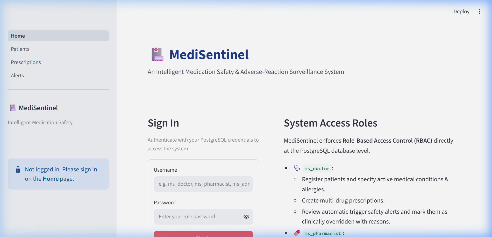
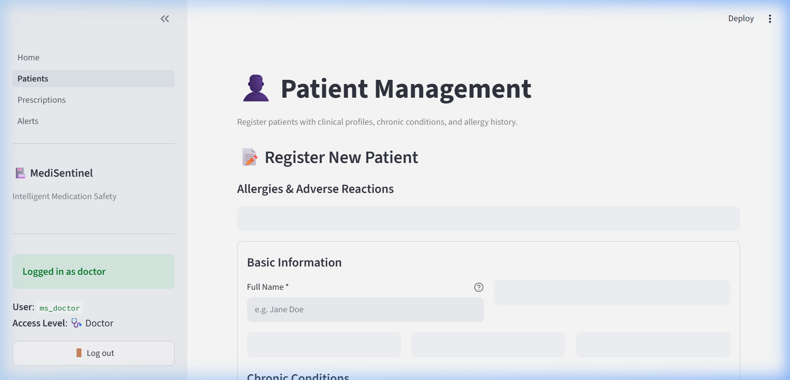
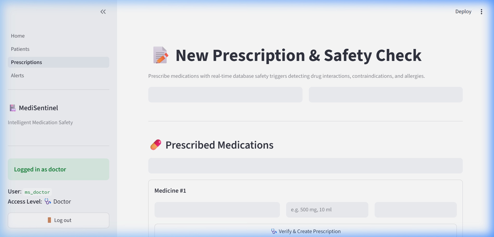
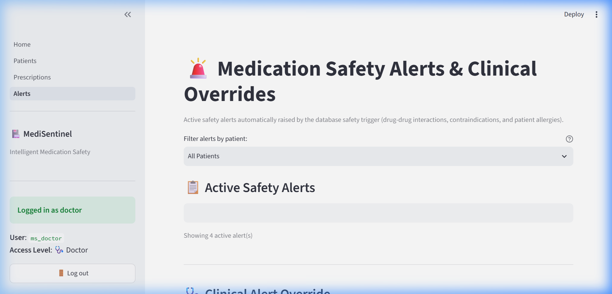

# MediSentinel Form Specifications & Validation Architecture

This document describes all interactive user interfaces and form workflows in the **MediSentinel** application (`app/`), covering form purposes, role permissions, field schemas, validation rules, exact error messages, database functions, and defense-in-depth data integrity guarantees.

---

## Architecture Overview

MediSentinel employs a **two-tier defense-in-depth architecture** for input verification:

1. **Client & Application Layer (`app/validation.py`)**: Pure, side-effect-free validation functions evaluate user input prior to database execution. All validation issues are collected and presented simultaneously as user-friendly error banners (`st.error`), preventing unnecessary network traffic or failed database transactions.
2. **Database Constraint & Trigger Layer (`sql/schema.sql`, `sql/roles.sql`)**: PostgreSQL integrity rules (`CHECK` constraints, foreign keys, unique indexes, and table triggers) enforce strict data validity at the database engine level, ensuring data consistency even against external API calls or script bypasses.

---

## 1. Authentication Page (`app/Home.py`)

### Purpose
Authenticates medical staff directly against PostgreSQL database roles (`ms_doctor`, `ms_pharmacist`, `ms_admin`). Upon successful authentication, the connection handle and role metadata are preserved in Streamlit's session state (`st.session_state`).

### Screenshots


### Authorized Roles
- **All registered database users**: `ms_doctor`, `ms_pharmacist`, `ms_admin`.

### Form Fields & Schema

| Field Name | Input Type | Validation Rules | Exact Error Message |
|---|---|---|---|
| **Username** | `st.text_input` (text) | Required; non-empty string | `"Please enter both username and password."` |
| **Password** | `st.text_input` (type="password") | Required; non-empty string | `"Please enter both username and password."` |

### Database Functions Called
- `medisentinel.db.connect(username, password)`: Initiates a direct `psycopg` connection to PostgreSQL with `row_factory=dict_row` and `autocommit=True`.
- `medisentinel.db.role_of(conn)`: Resolves the logged-in role (`"doctor"`, `"pharmacist"`, `"admin"`) based on `conn.info.user`.

### Security & Error Handling
- **Credential Protection**: Catches `psycopg.OperationalError` upon incorrect login and exclusively displays the sanitized message:
  ```text
  "Invalid username or password"
  ```
  Raw PostgreSQL connection strings, socket addresses, and internal database errors are never exposed to the client.

---

## 2. Patients Page (`app/pages/1_Patients.py`)

### Purpose
Enables clinical personnel to enroll new patients with complete medical baselines—including kidney/liver organ function metrics, chronic conditions, and medication allergies with adverse reaction details. Also renders an interactive table of all registered patients.

### Screenshots


### Authorized Roles
- **Doctor (`ms_doctor`) / Admin (`ms_admin`)**: Full registration privileges (form visible and interactive).
- **Pharmacist (`ms_pharmacist`)**: Read-only view. The registration form is hidden, displaying:
  ```text
  "ℹ️ Read-Only Mode: Pharmacists cannot register new patients. You can view existing patient records below."
  ```

### Form Fields & Schema

| Field Name | Input Type | Validation Rules | Exact Error Message |
|---|---|---|---|
| **Full Name \*** | `st.text_input` | Required; 2–100 characters; letters, spaces, dots (`.`), and apostrophes (`'`) only | `"Name is required."`<br>`"Name must be between 2 and 100 characters."`<br>`"Name may only contain letters, spaces, dots, and apostrophes."` |
| **Date of Birth \*** | `st.date_input` | Required; cannot be in the future; patient age between 0 and 120 years | `"Date of birth is required."`<br>`"Date of birth cannot be in the future."`<br>`"Age cannot exceed 120 years."` |
| **Gender \*** | `st.selectbox` (`constants.GENDERS`) | Required selection (`M`: Male, `F`: Female, `O`: Other) | PostgreSQL check constraint: `CHECK (gender IN ('M','F','O'))` |
| **Kidney Function \*** | `st.selectbox` (`constants.ORGAN_FUNCTION`) | Required selection (`normal`, `impaired`, `severe`) | Populated from predefined system constants |
| **Liver Function \*** | `st.selectbox` (`constants.ORGAN_FUNCTION`) | Required selection (`normal`, `impaired`, `severe`) | Populated from predefined system constants |
| **Pre-existing Conditions** | `st.multiselect` | Optional; selected from known contraindication and patient history conditions | Populated from `db.list_conditions(conn)` |
| **Medication Allergies** | `st.multiselect` | Optional; selected from available medications | Populated from `db.list_medications(conn)` |
| **Allergy Reactions** | `st.text_input` (dynamic per selected medication) | Optional descriptive reaction text (e.g., hives, rash, anaphylaxis) | Sanitized string passed to allergy records |

### Database Functions Called
- `medisentinel.db.list_conditions(conn)`: Queries distinct condition names across `Contraindication` and `Patient_Condition` tables.
- `medisentinel.db.list_medications(conn)`: Returns cataloged medications (`med_id`, `name`, `generic_name`).
- `medisentinel.db.list_patients(conn)`: Fetches registered patients for tabular display.
- `medisentinel.db.add_patient(conn, full_name, dob, gender, renal, hepatic, conditions, allergies)`: Inserts patient baseline and associated condition/allergy records within a single atomic transaction.

### User Feedback & Exceptions
- **Success**: Displays `"Patient #<id> saved"`.
- **Privilege Failure**: Catches `psycopg.errors.InsufficientPrivilege` and displays:
  ```text
  "Your role is not allowed to do this"
  ```

---

## 3. Prescriptions Page (`app/pages/2_Prescriptions.py`)

### Purpose
Allows prescribing physicians to create multi-medication prescriptions (1 to 6 items) while invoking PostgreSQL clinical safety triggers (`trg_medication_safety`) in real time to intercept dangerous drug-drug interactions, condition contraindications, and patient allergies.

### Screenshots


### Authorized Roles
- **Doctor (`ms_doctor`) / Admin (`ms_admin`)**: Full prescription creation privileges.
- **Pharmacist (`ms_pharmacist`)**: Read-only notice. Prescription form is hidden:
  ```text
  "ℹ️ Read-Only Mode: Pharmacists cannot create prescriptions. You can review and verify alerts on the Alerts page."
  ```

### Form Fields & Schema

| Field Name | Input Type | Validation Rules | Exact Error Message |
|---|---|---|---|
| **Select Patient \*** | `st.selectbox` | Required; valid registered patient selection | Maps to `patient_id` |
| **Prescribing Doctor \*** | `st.selectbox` | Required; valid doctor record selection | Maps to `doctor_id` |
| **How many medicines?** | `st.number_input` | Integer between 1 and 6 | Constrained by input boundaries (min 1, max 6) |
| **Medication #{i} \*** | `st.selectbox` | Required; valid medication; cannot select same medicine twice in one prescription | `"Item #{idx}: medicine must be selected."`<br>`"Item #{idx}: duplicate medicine detected (each medicine can only be included once)."` |
| **Dose #{i} \*** | `st.text_input` | Required; positive numeric value followed by an allowed unit (`mg`, `g`, `mcg`, `ml`, `IU`, `units`) | `"Item #{idx}: Dose is required."`<br>`"Item #{idx}: Dose must be a positive number followed by an allowed unit (mg, g, mcg, ml, IU, units)."`<br>`"Item #{idx}: Dose amount must be greater than zero."`<br>`"Item #{idx}: Invalid dose unit '<unit>'. Allowed units: mg, g, mcg, ml, IU, units."` |
| **Frequency #{i} \*** | `st.selectbox` (`constants.FREQUENCIES`) | Required; value from approved frequency list | `"Item #{idx}: frequency is required."`<br>`"Item #{idx}: invalid frequency '<freq>'. Allowed: ..."` |

### Database Functions Called
- `medisentinel.db.list_patients(conn)`: Populates patient dropdown.
- `medisentinel.db.list_doctors(conn)`: Populates physician dropdown.
- `medisentinel.db.list_medications(conn)`: Populates medication options.
- `medisentinel.db.create_prescription(conn, patient_id, doctor_id, items)`: Acquires advisory lock (`pg_advisory_xact_lock`), inserts prescription and item records, executes safety triggers, and returns `(prescription_id, alerts)`.

### Clinical Alert Display & Error Handling
- **No Alerts**:
  ```text
  "No safety issues found"
  ```
- **Triggered Alerts**: Displayed with color-coded severity:
  - `MAJOR`: Rendered via `st.error` (red banner).
  - `MODERATE`: Rendered via `st.warning` (amber banner).
  - `MINOR`: Rendered via `st.info` (blue banner).
- **Duplicate Medicine Violation**: Catches `psycopg.errors.UniqueViolation` and displays:
  ```text
  "This medicine is already in the prescription"
  ```
- **Role Violation**: Catches `psycopg.errors.InsufficientPrivilege` and displays:
  ```text
  "Your role is not allowed to do this"
  ```

---

## 4. Alerts Page (`app/pages/3_Alerts.py`)

### Purpose
Provides a consolidated surveillance view of active medication safety alerts across all patients. Allows physicians to record clinical justifications and override alerts when benefits outweigh safety risks.

### Screenshots


### Authorized Roles
- **Doctor (`ms_doctor`)**: Can view all active alerts, filter by patient, and submit clinical override justifications.
- **Pharmacist (`ms_pharmacist`)**: Can inspect active alerts and filter by patient in read-only mode. Override form is hidden, displaying:
  ```text
  "ℹ️ Pharmacist / View-Only Mode: Only doctors can override clinical safety alerts."
  ```

### Form Fields & Schema

| Field Name | Input Type | Validation Rules | Exact Error Message |
|---|---|---|---|
| **Filter alerts by patient** | `st.selectbox` | Optional filter (`"All Patients"` or individual patient) | Filter applied directly to query |
| **Select Alert to Override \*** | `st.selectbox` | Required; valid active alert selected from alert choice list | Maps to `alert_id` |
| **Clinical Override Reason \*** | `st.text_area` | Required; non-empty string justification | `"Override reason is required. An alert cannot be overridden without clinical justification."` |

### Database Functions Called
- `medisentinel.db.list_patients(conn)`: Populates patient filter options.
- `medisentinel.db.get_active_alerts(conn, patient_id=None)`: Queries view `v_active_alerts` (joins `Alert_Log`, `Prescription_Item`, `Prescription`, `Patient`, and `Medication` where `overridden = FALSE`).
- `medisentinel.db.override_alert(conn, alert_id, reason)`: Atomically updates `Alert_Log` with `overridden = TRUE` and records the audit reason.

### User Feedback & Exceptions
- **Success**: Displays `"Alert #<id> overridden successfully!"` and triggers `st.rerun()`, refreshing the table immediately.
- **Role Violation**: Catches `psycopg.errors.InsufficientPrivilege` and displays:
  ```text
  "Your role is not allowed to do this"
  ```

---

## Master Validation Rules Reference Table

The following table summarizes all client-side validation rules enforced in `app/validation.py` along with their corresponding database constraints:

| Entity / Target | Function Name | Field Name | Validation Rule | Exact Error Message | Database Constraint (`sql/schema.sql`) |
|---|---|---|---|---|---|
| **Patient** | `validate_name` | Full Name | Required | `"Name is required."` | `full_name VARCHAR(100) NOT NULL` |
| **Patient** | `validate_name` | Full Name | 2 to 100 characters | `"Name must be between 2 and 100 characters."` | `VARCHAR(100)` |
| **Patient** | `validate_name` | Full Name | Letters, spaces, dots (`.`), apostrophes (`'`) | `"Name may only contain letters, spaces, dots, and apostrophes."` | Application-level regex check |
| **Patient** | `validate_dob` | Date of Birth | Required | `"Date of birth is required."` | `date_of_birth DATE NOT NULL` |
| **Patient** | `validate_dob` | Date of Birth | Date cannot be in the future | `"Date of birth cannot be in the future."` | Checked before DB insert |
| **Patient** | `validate_dob` | Date of Birth | Age must be between 0 and 120 years | `"Age cannot exceed 120 years."` | Checked before DB insert |
| **Patient** | N/A (UI Selectbox) | Gender | Must be `'M'`, `'F'`, or `'O'` | Selected via `constants.GENDERS` | `gender CHAR(1) CHECK (gender IN ('M','F','O'))` |
| **Prescription Item** | `validate_dose` | Dose | Required | `"Dose is required."` | `dose VARCHAR(40)` |
| **Prescription Item** | `validate_dose` | Dose | Positive number followed by valid unit | `"Dose must be a positive number followed by an allowed unit (mg, g, mcg, ml, IU, units)."` | Application regex check |
| **Prescription Item** | `validate_dose` | Dose | Number must be > 0 | `"Dose amount must be greater than zero."` | Application float comparison |
| **Prescription Item** | `validate_dose` | Dose | Unit must be in `DOSE_UNITS` | `"Invalid dose unit '<unit>'. Allowed units: mg, g, mcg, ml, IU, units."` | Application set membership |
| **Prescription Item** | `validate_items` | Prescription Items | At least one medicine item | `"Prescription must contain at least one medicine."` | `db.create_prescription` ValueError check |
| **Prescription Item** | `validate_items` | Medication | No duplicate medicines in prescription | `"Item #{idx}: duplicate medicine detected (each medicine can only be included once)."` | `CONSTRAINT uq_item UNIQUE (prescription_id, med_id)` |
| **Prescription Item** | `validate_items` | Frequency | Must belong to `FREQUENCIES` | `"Item #{idx}: frequency is required."`<br>`"Item #{idx}: invalid frequency '<freq>'. Allowed: ..."` | Predefined enum validation |
| **Alert Override** | Form Check | Override Reason | Non-empty text justification | `"Override reason is required. An alert cannot be overridden without clinical justification."` | `db.override_alert` ValueError (`"an override needs a reason"`) |
