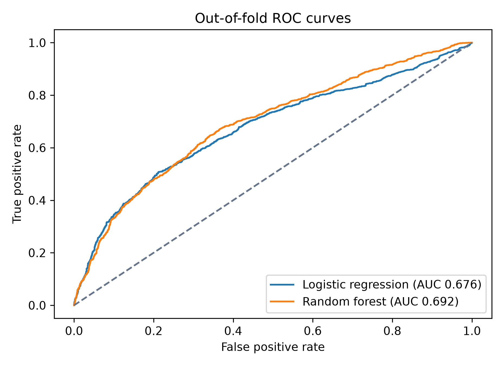
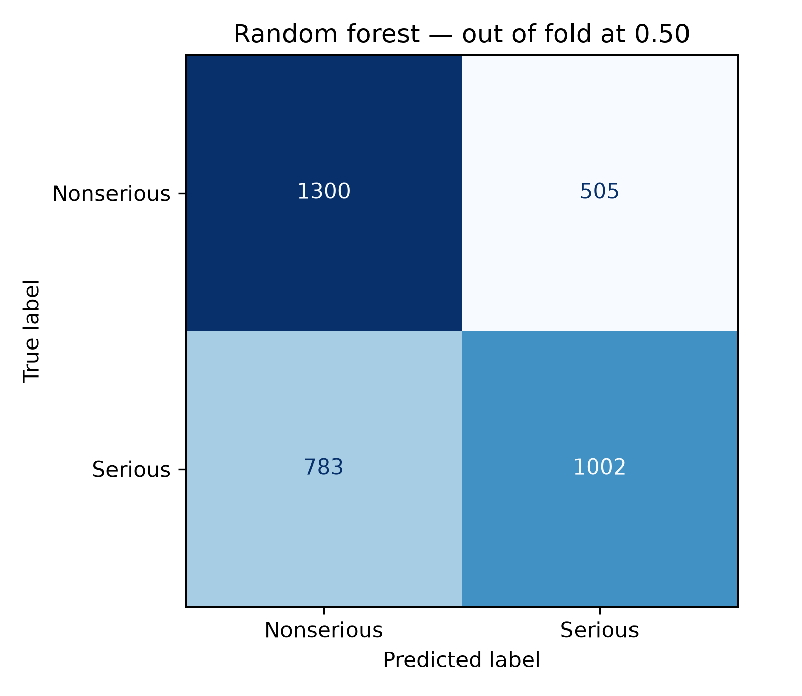
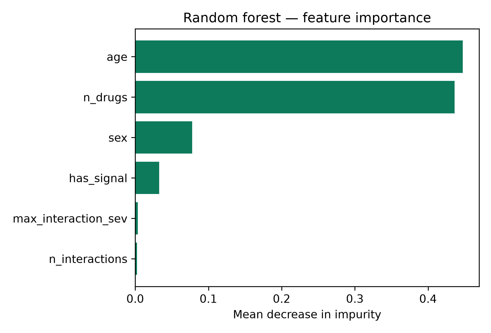

# Machine learning risk scoring

## Problem and approach

The safety trigger reports the severity of a specific rule. A separate classifier estimates how likely a report with similar features would carry the serious flag in the FAERS training sample. The score can help describe alert context in the lab demo. Evidence from clinical prescriptions would be needed to interpret it as an individual patient's risk. [FDA adverse-event data and limitations](https://open.fda.gov/apis/drug/event/).

## Method

```text
FAERS reports + PostgreSQL rules and signals → shared features → stratified cross-validation
                                             → selected model → live display or admin backfill
```

The positive class is FAERS `serious = 1`. Reports with missing or unusable onset age were excluded. The dataset builder matches harmonized generic names and reported product names to the medication catalogue. It counts every reported drug entry for regimen size and counts each known interacting medication pair once. The live form and the admin job use the same feature order and pair logic with the patient's current active prescription items.

| Feature | FAERS input | Alert input |
|---|---|---|
| Age | Onset age converted from the reported unit to years | Completed years from date of birth |
| Sex | Reported male, female or unknown | PostgreSQL recorded male, female or other/unknown |
| Drug count | Number of reported drug entries | Number of items in active prescriptions |
| Maximum interaction severity | Highest matched pair severity, encoded from 0 to 3 | Highest pair severity in the active regimen, same encoding |
| Interaction count | Number of distinct matched pairs | Number of distinct matching active pairs |
| Signal present | A matched medicine has an `Adverse_Signal` row | An active medicine has an `Adverse_Signal` row |

Class-balanced logistic regression with standardized inputs served as the baseline. A class-balanced random forest captured nonlinear relationships. Both used the same five stratified folds and random seed 42. The mean fold ROC-AUC selected the winner. Precision, recall and F1 used a 0.5 probability threshold. The selected model was refitted on all usable reports and saved for live and batch inference. [Scikit-learn](https://jmlr.org/papers/v12/pedregosa11a.html).

## Results

The training table retained 3,590 reports, including 1,785 serious and 1,805 nonserious reports. The random forest achieved the higher mean ROC-AUC and F1. The logistic model had higher precision at the reporting threshold.

| Classifier | Mean ROC-AUC | Precision | Recall | F1 |
|---|---:|---:|---:|---:|
| Logistic regression | 0.678 | 0.697 | 0.509 | 0.588 |
| Random forest | 0.693 | 0.665 | 0.561 | 0.608 |



*Figure 1. ROC curves pooled from out-of-fold predictions. The legend shows pooled AUC. The table shows means across the folds.*



*Figure 2. Held-out predictions from the selected random forest, classified at 0.5.*



*Figure 3. Random forest impurity-based feature importance on the final fitted model. Importance describes the model's use of a feature.*

The admin job stored scores for all four seeded alerts. Their scores ranged from 0.571 to 0.944. All four were Major, so this snapshot cannot establish a Major-versus-Minor score relationship.

## Discussion and limitations

FAERS is a spontaneous reporting system. Reporting bias, incomplete reports, uncertain medicine matching, and the gap between reported onset and live prescribing limit generalization. The local training snapshot contained curated rules and seeded adverse signals. Retraining after the team's reviewed import may change results. Alerts sharing the same patient and regimen can receive equal scores because the model uses regimen-level features. Its probability has not been calibrated against outcomes in a clinical patient cohort. [FDA adverse-event data and limitations](https://open.fda.gov/apis/drug/event/).

## Screenshots

**Report placement:** Insert the prescription result and Analytics risk distribution screenshots. Identify the prescription result as a live prediction and the Analytics distribution as stored scores.
